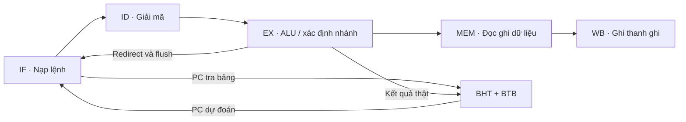
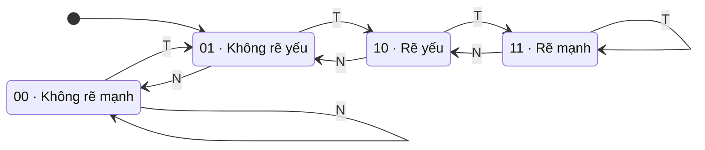

# Đặc tả thiết kế

## Tập lệnh và bộ nhớ

CPU có 32 thanh ghi 32 bit. Thanh ghi `$0` luôn bằng 0. PC và địa chỉ dữ liệu tính theo byte. Testbench gắn hai bộ nhớ 1024 word riêng, đọc tổ hợp và ghi đồng bộ. Tất cả truy cập word hợp lệ phải thẳng hàng và nằm trong vùng mô phỏng. Chương trình benchmark kết thúc tại nhãn `end:` sau lệnh NOP cuối. Từ nhãn đó trở đi, vùng lệnh đệm bằng mã không hỗ trợ `ffffffff`, không tạo retirement. Quy ước này cho testbench chạy thêm các chu kỳ kiểm tra yên lặng.

| Nhóm lệnh | Ngữ nghĩa |
|---|---|
| `addu`, `subu` | Cộng, trừ theo modulo 2³² |
| `addiu` | Cộng với hằng 16 bit mở rộng dấu |
| `slt` | So sánh hai toán hạng có dấu |
| `sll` | Dịch trái logic theo `shamt` |
| `lw`, `sw` | Địa chỉ bằng thanh ghi cơ sở cộng offset mở rộng dấu |
| `beq`, `bne` | So sánh hai thanh ghi. Đích là `PC + 4 + (sign_extend(imm16) << 2)` |

Đặc tả đồ án chọn nhánh có hiệu lực ngay và không có delay slot. Lõi single-cycle cung cấp một đường thực thi khác để kiểm tra cùng tập lệnh. Trình thông dịch Python là tham chiếu độc lập về ISA cho cả hai lõi.

## Pipeline và hazard

Thanh ghi giữa các tầng có bit hợp lệ. Bypass từ EX/MEM hoặc MEM/WB cấp toán hạng mới nhất cho ALU, bộ so sánh nhánh và dữ liệu ghi store. Bypass từ WB tới ID xử lý lệnh đọc đồng thời với lần ghi. Khi lệnh ở ID cần dữ liệu của `lw` đang ở EX, giữ PC và IF/ID một chu kỳ rồi chèn bubble vào EX. Nạp lệnh tiếp sau khi có thể forward dữ liệu.

Trong chế độ chờ nhánh, ID ngừng nạp lệnh khi nhánh có thể tiến sang EX, và EX chọn PC đúng để tiếp tục. Trong các chế độ dự đoán, IF ghi lại hướng, BTB hit và PC đã chọn cùng lệnh nhánh. Khi EX phát hiện PC đã chọn khác PC đúng, CPU giữ nhánh đang giải quyết và hủy hai lệnh trẻ hơn ở IF và ID. Store trên đường sai bị hủy trước khi tới MEM. Một lệnh đang ở EX chỉ có thể là load hoặc branch, vì vậy xung đột flush và load-use stall không phát sinh trong đường thực thi hiện tại.

## Bộ dự đoán

| MODE | Hành vi tại IF |
|---|---|
| 0 | Chờ cho đến khi nhánh được xác định |
| 1 | Luôn đi tiếp tại `PC + 4` |
| 2 | Dự đoán 1 bit theo lần thực thi gần nhất và tra BTB |
| 3 | Dự đoán với bộ đếm bão hòa 2 bit và tra BTB |
| 4 | Lõi single-cycle do testbench chọn để kiểm tra ISA |

`INDEX_BITS` chọn 16, 64 hoặc 256 mục bằng giá trị 4, 6 hoặc 8. Với 64 mục, `PC[7:2]` là chỉ số và `PC[31:8]` là tag BTB. BHT không có tag, vì vậy các nhánh trùng chỉ số chia sẻ trạng thái. BTB chỉ trả đích nếu mục hợp lệ và tag khớp. Nếu miss, IF chọn `PC + 4` bất kể dự đoán hướng thô.

Bộ đếm 2 bit khởi tạo ở `01`. Chuyển một bước về `11` khi rẽ hoặc về `00` khi không rẽ và giữ nguyên khi chạm biên. Bit cao quyết định hướng thô. BP chỉ cập nhật ở cạnh lên khi EX giải quyết một nhánh hợp lệ. BTB lưu đích của nhánh hợp lệ kể cả khi lần đó không rẽ. Dự đoán nhận ở cùng cạnh lên sử dụng trạng thái trước lần cập nhật của cạnh đó.

`T` là nhánh thực tế rẽ và `N` là nhánh thực tế đi tiếp. Khi `update_valid = 0`, trạng thái giữ nguyên. Giao diện RTL của [branch_predictor.v](../rtl/branch_predictor.v) nối hai đầu pipeline như sau.

| Tín hiệu | Hướng | Vai trò |
|---|---|---|
| `clk`, `reset` | Vào | Cạnh lên cập nhật bảng. Reset đồng bộ đặt BHT về trạng thái ban đầu và xóa valid của BTB |
| `lookup_pc[31:0]` | Vào từ IF | Tra tổ hợp chỉ số BHT và kiểm tra tag BTB |
| `raw_taken`, `hit` | Ra tới IF | Hướng từ BHT và kết quả so khớp BTB |
| `pred_taken`, `pred_next_pc[31:0]` | Ra tới IF | Nếu `raw_taken && hit` thì chọn đích BTB. Các trường hợp còn lại chọn `lookup_pc + 4` |
| `update_valid`, `update_pc[31:0]` | Vào từ EX | Cho phép cập nhật mục tương ứng với PC của nhánh hợp lệ |
| `update_taken`, `update_target[31:0]` | Vào từ EX | Kết quả thật dùng để cập nhật hướng và địa chỉ đích |

## Kiểm thử và số liệu

`generate.py` lắp ráp và chạy mỗi chương trình trong trình thông dịch tham chiếu. Testbench so từng PC retirement, lần ghi thanh ghi, lần ghi bộ nhớ và kết quả nhánh EX với trace. Nó còn kiểm tra lần ghi thực lên cổng RAM, toàn bộ RAM cuối và các chu kỳ sau retirement cuối. Bài kiểm tra `hazards_flush` chứa store ở đường sai. `zero_offset` chứa nhánh mà target bằng `PC + 4`. `aliasing` dùng hai PC nhánh cách nhau 256 byte để tạo tranh chấp ở bảng 16 và 64 mục.

Với ba chế độ dự đoán, [mô hình Python](../prediction_trace.py) dựng lại BHT và BTB từ các nhánh hợp lệ tại EX, tự tính địa chỉ đích từ ảnh lệnh. Mỗi chu kỳ nó kiểm tra đầu ra IF trước khi áp dụng cập nhật của cạnh clock đó. Mô hình cũng kiểm tra PC nạp ở chu kỳ sau và đối chiếu dữ liệu dự đoán đi từ IF tới EX qua stall hoặc flush. `run.py` chỉ ghi số liệu sau khi cả hai lớp kiểm thử đạt.

Đếm chu kỳ từ cạnh clock hoạt động đầu tiên sau reset đến retirement cuối. Không tính các chu kỳ kiểm tra yên lặng sau đó. Mọi cấu hình chạy từ cùng trạng thái khởi tạo.

- `raw_accuracy_pct` đo hướng do BHT đề xuất trước khi kiểm tra BTB.
- `direction_accuracy_pct` đo quyết định rẽ thực sự dùng ở IF sau khi kiểm tra BTB.
- `next_pc_accuracy_pct` đo PC đã chọn có bằng PC đúng hay không. Nhánh offset 0 có thể sai hướng nhưng đúng PC.
- `btb_hit_rate_pct` đo tỷ lệ khớp BTB trên các lần thực thi nhánh hợp lệ.
- `CPI = cycles / retired`. Với các chương trình của suite, phép đối chiếu chu kỳ là `retired + 4 + load_stalls + branch_stalls + 2 × flushes`.
- Tốc độ tương đối ở cùng chu kỳ clock là `cycles_đối_chứng / cycles_thử`. Tỷ lệ chu kỳ tiết kiệm là `1 − cycles_thử / cycles_đối_chứng`.

[branch_stats.csv](../results/branch_stats.csv) gom số liệu theo chương trình, cấu hình và PC nhánh. Mỗi lần chọn sai PC được xếp đúng một nhóm theo thứ tự kiểm tra sau.

1. `wrong_pc_direction` nếu hướng thô khác kết quả thật, kể cả khi đồng thời BTB miss.
2. `wrong_pc_btb_miss` nếu hướng thô đúng nhưng BTB miss khiến IF đi sai đường.
3. `wrong_pc_target` nếu hướng thô đúng, BTB hit nhưng đích đã chọn sai.

Tổng ba nhóm bằng `next_pc_misses`. Sai hướng ở nhánh có đích bằng `PC + 4` có thể làm tăng `raw_direction_misses` nhưng vẫn chọn đúng PC.

Lý thuyết về BHT, BTB và control hazard có tại [bài giảng của Unicamp](https://ic.unicamp.br/en/~rodolfo/Cursos/mc732/2026s2/slides/C04C-branch-prediction/). Quy ước MIPS học tập không có delay slot có ví dụ trong [đồ án Cornell](https://www.cs.cornell.edu/people/egs/comp303/projects123/Project3.pdf).
