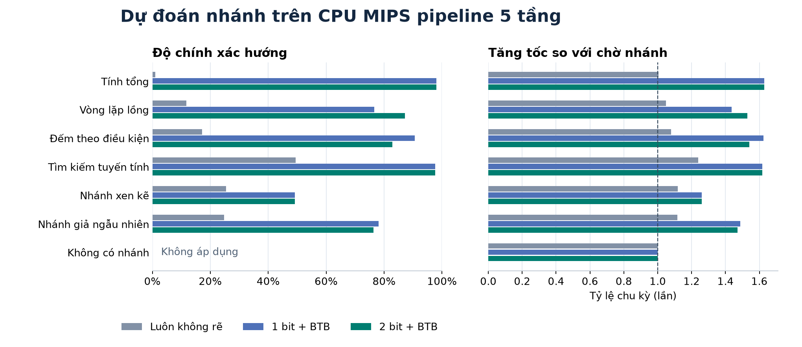

# Đánh giá bộ dự đoán nhánh trên CPU MIPS pipeline

## Tóm tắt

Bộ dự đoán **2 bit + BTB 64 mục** đoán đúng hướng **1.016/1.327 nhánh (76,56%)** trên bảy chương trình benchmark. CPU thực thi cùng 3.240 lệnh trong **4.414 chu kỳ**, so với **6.446 chu kỳ** khi chờ xác định nhánh. Với cùng chu kỳ clock, tốc độ đạt **1,46 lần** và thời gian thực thi giảm **31,52%**. So với dự đoán tĩnh luôn không rẽ, tốc độ đạt **1,33 lần**, tương ứng giảm **24,75%** số chu kỳ.

## Thiết lập thực nghiệm

Lõi Verilog-2005 chạy tập con MIPS 32 bit trên pipeline IF, ID, EX, MEM, WB. Bốn cấu hình dùng cùng chương trình, dữ liệu, bộ nhớ và forwarding. Mỗi lượt bắt đầu từ reset. Mô phỏng bằng Icarus Verilog 13.0; testbench kiểm tra thứ tự lệnh hoàn tất, kết quả nhánh, lần ghi thanh ghi, cổng ghi RAM và toàn bộ RAM cuối với mô hình Python. Đã chạy 87 lượt CPU trên 11 chương trình, gồm lõi single-cycle kiểm tra ISA và các cấu hình quét kích thước. Testbench riêng của BP kiểm tra bão hòa, reset, xung đột tag và đọc/cập nhật cùng cạnh.

Số chu kỳ bao gồm thời gian nạp/xả pipeline và các lần đoán sai lúc bảng còn lạnh. Accuracy hướng tính trên quyết định thực sự dùng ở IF sau khi kiểm tra BTB. Accuracy toàn bộ cộng số lần đoán đúng rồi chia tổng số nhánh. Tỷ lệ tăng tốc toàn bộ lấy tổng chu kỳ của hai cấu hình để tính.

## Kết quả ở cấu hình 64 mục

| Chương trình | Lệnh | Nhánh | Chờ EX | Luôn không rẽ | 1 bit | 2 bit | Đúng hướng 2 bit | Tốc độ 2 bit / chờ EX |
|---|---:|---:|---:|---:|---:|---:|---:|---:|
| Tính tổng | 304 | 100 | 508 | 506 | 312 | 312 | 98,00% | 1,63× |
| Vòng lặp lồng | 544 | 180 | 908 | 866 | 632 | 594 | 87,22% | 1,53× |
| Đếm theo điều kiện | 421 | 192 | 905 | 839 | 557 | 587 | 82,81% | 1,54× |
| Tìm kiếm tuyến tính | 223 | 87 | 445 | 359 | 275 | 275 | 97,70% | 1,62× |
| Nhánh xen kẽ | 581 | 256 | 1.225 | 1.095 | 973 | 973 | 49,22% | 1,26× |
| Nhánh giả ngẫu nhiên | 1.155 | 512 | 2.439 | 2.185 | 1.639 | 1.657 | 76,37% | 1,47× |
| Không có nhánh | 12 | 0 | 16 | 16 | 16 | 16 | — | 1,00× |
| **Tổng** | **3.240** | **1.327** | **6.446** | **5.866** | **4.404** | **4.414** | **76,56%** | **1,46×** |

Bốn cột chế độ ghi số chu kỳ. Dữ liệu từng lượt ở [metrics.csv](metrics.csv).

Vòng tính tổng có 99 lần rẽ liên tiếp và một lần thoát. BP 2 bit sai ở lần đầu và lúc thoát. Trên vòng lặp lồng, bộ đếm giữ khuynh hướng rẽ sau một lần thoát vòng trong, giảm số lần flush từ 42 xuống 23 so với 1 bit.

Khi dữ liệu đổi theo từng khối, bộ 1 bit đổi hướng ngay sau lần sai đầu tiên. Trong bài đếm theo điều kiện, 1 bit mất 18 lần flush, còn 2 bit mất 33. Với chuỗi xen kẽ, dự đoán từ lịch sử của từng nhánh gặp khó khăn. Accuracy 49,22% của bài này gộp cả nhánh dựa vào dữ liệu và nhánh điều khiển vòng lặp. Tổng trên bảy chương trình, 1 bit đúng 1.021/1.327 nhánh (76,94%) và nhanh hơn 2 bit 10 chu kỳ.

CPI tổng giảm từ 1,9895 xuống 1,3623 giữa chế độ chờ và bộ 2 bit. Hai cấu hình cùng mất 524 chu kỳ do load-use. Chế độ chờ mất 2.654 chu kỳ ở nhánh. Bộ 2 bit dùng 311 lần flush, tương ứng 622 chu kỳ. Hiệu số là 2.032 chu kỳ, đúng với chênh lệch đo được.

## Kích thước bảng và xung đột địa chỉ

Hai nhánh tại `0x00c` và `0x10c` trùng chỉ số ở bảng 16 và 64 mục. Chúng có khuynh hướng ngược nhau nên ghi đè BTB và chia sẻ bộ đếm BHT. Bảng 256 mục tách hai nhánh.

| Mục BHT/BTB | Bit lưu trữ BP 2 bit | BTB hit trong ca aliasing | Đúng hướng | Flush | Chu kỳ |
|---:|---:|---:|---:|---:|---:|
| 16 | 976 | 78/239 | 66,11% | 81 | 568 |
| 64 | 3.776 | 78/239 | 66,11% | 81 | 568 |
| 256 | 14.592 | 235/239 | 98,33% | 4 | 414 |

Mỗi mục dùng 2 bit BHT, 1 bit valid, tag rộng `30 − INDEX_BITS` và địa chỉ đích 32 bit. Số bit trên là dung lượng trạng thái RTL, chưa quy đổi sang tài nguyên tổng hợp. Bảng 64 mục của bộ 1 bit cần 3.712 bit. Bảy benchmark chính cho cùng số chu kỳ ở cả ba kích thước do các địa chỉ nhánh của chúng không tạo xung đột ảnh hưởng đến kết quả trong phép quét.

## Kiểm tra cơ chế phục hồi và phạm vi kết quả

Trong `hazards_flush`, nhánh tại `0x08` đoán PC tiếp theo là `0x0c` nhưng địa chỉ đúng là `0x14`. Testbench xác nhận đường sai không ghi store vào `0x7fc`. Trong `zero_offset`, bộ 2 bit đoán đúng hướng 97,50% và đúng PC 98,33%. Nhánh đích bằng `PC + 4` minh họa sai hướng vẫn có thể nạp đúng địa chỉ.

Thiết kế dùng ISA rút gọn, không có delay slot, RAM/ROM lý tưởng và chương trình tổng hợp nhỏ. Tỷ lệ tăng tốc dựa trên số chu kỳ với giả định clock bằng nhau. Đánh giá tần số thực cần tổng hợp và phân tích đường tới hạn trên một đích phần cứng xác định.
